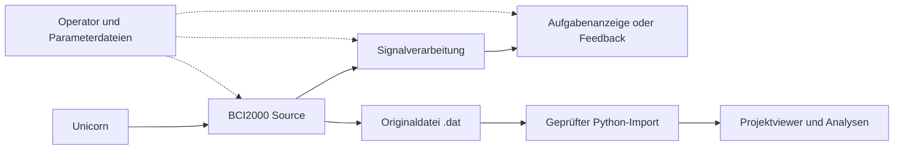

# BCI2000 im EEGvsMEG-Projekt: Einsatzmöglichkeiten und Integrationsentscheidung

Recherche: **12.11.2026**, Projektbasis `017a84d` auf `main`. Untersucht wurden Projektanleitungen, Aufnahme-/Importcode und offizielle BCI2000-, MNE- und LSL-Quellen. Die folgenden Abschnitte dokumentieren die ursprüngliche Machbarkeitsuntersuchung.

**Nachfolgende Umsetzung:** Der [Offline-Weg für macOS/Windows](bci2000-offline.md) ist inzwischen implementiert: eigener kalibrierter DAT-Reader, CSV-Export mit Trial-/Attempt-Erhalt und Folds, beide Viewer und Runner für native Offline-Filter. Die Python-Seite ist hardwarefrei geprüft; ein echter nativer BCI2000-Lauf steht aus. Aufnahme, Feedback und Versuchssteuerung sind weiterhin Vorschläge dieses Berichts und wurden auf Nutzerwunsch nicht umgesetzt.

## 1. Ergebnis und Empfehlung

**BCI2000 passt besonders als ergänzende Echtzeit- und Experimentierplattform:** für eine unabhängige Unicorn-Aufnahme, klassische sensomotorische Vergleichspipelines, Live-Signalprüfung, Feedback und spätere Steuerungsdemonstrationen. Eine sofortige Ablösung der bestehenden Sitzungs-CLI bringt dagegen erheblichen Anpassungs- und Validierungsaufwand.

Der konkrete Hardwareanschluss ist dokumentiert: `gUnicornADC` unterstützt das Unicorn mit acht EEG-Kanälen bei 250 Hz und führt Bewegungssensoren sowie Gerätestatus als States. Ob das heruntergeladene Paket den passenden ausführbaren Source-Build enthält und mit unserer DLL-/Geräteversion funktioniert, muss auf dem Windows-Messrechner geprüft werden. ([Unicorn-Referenz][s1])

Empfohlene Reihenfolge:

1. **Datenimport und hardwarefreie Verarbeitung prüfen.** Kalibrierung, Kanalnamen und sämtliche benötigten States müssen erhalten bleiben. Der vorhandene MNE-Reader reicht in der hier geprüften Version allein nicht aus; konkreter Befund in Abschnitt 6.
2. **BCI2000 separat mit Unicorn erproben.** Kurzer Techniklauf und Signal-/Timingprüfung, anschließend Abgleich mit einer gesonderten Aufnahme des bisherigen Rohdatenrecorders. Nur ein Programm öffnet das Headset.
3. **Klassische Offline-Pipeline als weitere Referenz untersuchen.** Zunächst `MI_HandSide` und `MI_Bilateral`, mit denselben gültigen Trials und denselben Testpartitionen wie im Projekt.
4. **Bei Bedarf eine einseitige Datenbrücke ergänzen.** Bestehende Aufnahme und Sitzungssteuerung bleiben verantwortlich; BCI2000 erhält Daten für Beobachtung und Versuche ohne Teilnehmerfeedback.
5. **Feedback und Steuerung als eigenen Versuch entwickeln.** Ein BCI2000-Anwendungsmodul für das vollständige Protokoll erst dann erwägen, wenn der Nutzen gegenüber der bestehenden CLI konkret nachgewiesen ist.

Für das aktuelle Studienziel sind Schritte 1–3 am wertvollsten. Für eine spätere interaktive BCI-Demonstration gewinnen Schritte 4–5 an Bedeutung. BCI2000 schafft dabei die technische Versuchsumgebung; erfolgreiche Erkennung neuer Personen/Sitzungen bleibt eine empirische Frage.

## 2. Anschluss an den tatsächlichen Projektstand

| Bestehender Baustein | Festgestellter Stand | Konsequenz für BCI2000 |
|---|---|---|
| `gtec_Clib/terminal/session_plan.h`, `session.h` | Implementierte Sitzung 2.0: 168 Trials, zwölf Bedingungen, 2704 s; Seed, exakte Kontingente, Pausen und Wiederholungen | Plan und Zustandsregeln wiederverwenden oder vollständig nachbilden; Standard-Demo ist keine Umsetzung unseres Protokolls. |
| `recorder.h`, `acquisition/oscar_worker.py` | C-API-Rohdatenweg und exklusiver Python-/OSCAR-Weg; Rohdaten und bereinigte Ausgabe getrennt | Direkter BCI2000-Treiber wäre ein zusätzlicher Aufnahmeweg. Für den bisherigen OSCAR-Vertrag ist ein Adapter erforderlich. |
| `view_eeg.py`, `analysis/view_eeg.py` | Beide Einstiegspunkte importieren Projekt-CSV und Ereignisse; 250 Hz; Anzeige/FIF/weitere Ansichten | Beide benötigen bei einem neuen Format denselben geprüften Import. `.dat` ist derzeit kein unterstütztes CLI-Eingabeformat. |
| `analysis/recording_files.py`, `event_annotations.py` | Signalwahl sowie vollständiger Eventkontext einschließlich späterer Invalidierung | Datenvariante, Attempt-Status und Herkunft dürfen beim Austausch nicht verloren gehen. |
| `analysis/ml_data.py`, `session_conditions.py` | Getrennte Kontraste, gültige 3-s-Fenster und blockweise Aufteilung | Gleiche Datenauswahl für einen aussagekräftigen BCI2000-Vergleich. |
| `analysis/movement_classifier.py`, `movement_features.py` | Explorative kausale Offline-Merkmale und Diagnose-Replay; kein Live-Hardwareadapter | BCI2000 könnte Live-Daten/Feedback ergänzen; vorhandene `.npz`-Modelle sind kein direkt ladbares BCI2000-Modellformat. |
| CBraMod/REVE | Offline-Piloten mit eigener Vorverarbeitung und Modell-Pins | Live-Einbindung braucht eigene Schnittstelle und Laufzeitprüfung. Offline-Ergebnisse belegen keine Echtzeittauglichkeit. |
| MEG-Bezug | Vergleich mit MEGBCI2020 vorgesehen; keine implementierte gemeinsame Echtzeitaufnahme | BCI2000 ist optional für gemeinsame Verarbeitungsansätze, keine Voraussetzung für den Offline-Vergleich. |

Der dokumentierte Projektstand unterscheidet softwareseitige Tests von ausstehender Windows-/Headset-Abnahme. Insbesondere ist der OSCAR-Starttimeout im vorhandenen Fehlerbericht weiterhin offen; BCI2000 wurde hier nicht als dessen Lösung getestet.

Projektgrundlagen: [Versuchsprotokoll](experiment-protocol.md), [Sitzungsvertrag](session-automation-plan.md), [Aufnahme/OSCAR](../acquisition/README.md), [Bewegungsklassifikator](movement-classifier.md), [Teilnehmer-IDs](participant-ids.md).

## 3. Anwendungsfälle über den gesamten Projektumfang

Prioritäten: **A** = unmittelbarer Nutzen für die Studienarbeit; **B** = sinnvolle Erweiterung; **C** = neuer Forschungs-/Demonstrationszweig. Aufwand bezeichnet die geschätzte Integration samt notwendigen Prüfungen, keine gemessene Entwicklungsdauer. Die Nutzenbewertung ist unsere Ableitung aus Projektstand und dokumentierten Schnittstellen.

| Anwendungsfall | Konkreter Nutzen im Projekt | Technischer Ansatz und offene Arbeit | Priorität / Aufwand |
|---|---|---|---|
| 1. Alternative Rohdatenaufnahme | Zweiter technischer Aufnahmeweg; Vergleich bei Problemen mit eigener Geräteansteuerung | `gUnicornADC`; Daten-/Statusimport und Windows-Abnahme nötig; kein automatischer OSCAR-Ersatz. [Quelle][s1] | A / mittel |
| 2. Live-Signal- und Kontaktkontrolle | Vor Beginn auffällige Kanäle, Netzstörung, Clipping und Bewegungsartefakte erkennen | Quellsignalvisualisierung; feste sichtbare Skalen und dokumentierte Filter. Keine daraus abgeleitete Impedanzmessung behaupten. [Quelle][s2] | A / gering bis mittel |
| 3. Timing- und Lastdiagnose | Blockregelmäßigkeit, Verarbeitungszeit und Anzeigeverzögerungen untersuchen | Timinganzeige und Profiler; zusätzlich physikalische Messung des Anzeige-Onsets. [Timing][s3], [Profiler][s4] | A / mittel |
| 4. Klassische ML-Referenz | Mu-/Beta-, räumliche Filter-/CSP- und lineare Verfahren neben Bandpower, CBraMod und REVE vergleichen | `BCI2000Analysis` und dokumentierte Filter; gleiche gültige Trials und zurückgehaltene Blöcke/Sitzungen. [Quelle][s4] | A / mittel |
| 5. Reproduzierbare Offline-Verarbeitung | Ganze Filterketten mit gespeicherten Parametern erneut ausführen | BCI2000-Kommandozeilenverarbeitung; `.dat` oder geprüfte Konvertierung erforderlich. [Quelle][s5] | A / mittel |
| 6. Hardwarefreier Replay und Unterricht | Algorithmen, Anzeigen und Fehlerreaktionen ohne Headset entwickeln; reproduzierbare Demonstrationen | `SignalGenerator`, `FilePlayback`; Originaltiming und Original-States getrennt von Replayzeiten halten. [Generator-Beispiel][s6], [Replay][s7] | A / gering für BCI2000-Beispiele, mittel für Projektdaten |
| 7. Aufgabenanzeige und Versuchssteuerung | Alternative Oberfläche für Motorik, Imagery, Wortgenerierung und Subtraktion | `StimulusPresentation` unterstützt vordefinierte Stimuli/Sequenzen; eigene Trial-/Attempt-Logik bleibt nötig. [Quelle][s8] | B / hoch für vollständige Sitzung |
| 8. Kalibrierung und Imagery-Training | Individuelle sensomotorische Merkmale bestimmen, Feedbackstrategie erproben | Mu-Rhythmus-Tutorial: Aufnahme, Offline-Auswahl, Feedbacklauf. Eigener Trainingsversuch außerhalb der Hauptmessung. [Quelle][s9] | B / mittel |
| 9. Online-ERD/ERS und Neurofeedback | Mu-/Beta-Verläufe für Versuchsleitung oder Teilnehmer sichtbar machen | Spektralschätzung und separates Python-Display; Definition von Referenz, Fenster und Verzögerung an Projektanalyse angleichen. [Spektrum][s10], [Python-Display][s11] | B / mittel |
| 10. Cursor, Auswahlmenü, Spiel, VR | Verständliche interaktive BCI-Demonstration | `CursorTask` oder externe Anwendung über App Connector; Diskretisierung und tatsächliche Steuerqualität gesondert prüfen. [Cursor][s12], [Connector][s13] | B / mittel |
| 11. Eigenen Bewegungsklassifikator live betreiben | Vorhandenen Diagnose-Replay zu einer Online-Erkennung weiterentwickeln | Daten-/Modelladapter, exakt gleiche Merkmale, Zustandssperre und Auswertung kontinuierlicher Fehlalarme. Python-Ausführung oder eigener Filter. [Schnittstellen][s14] | B / mittel bis hoch |
| 12. CBraMod/REVE online untersuchen | Klassische und große Modelle unter denselben Daten-/Latenzbedingungen vergleichen | Externer Python-Prozess über SignalSharing oder eigenes Modul; Fenster, Vorverarbeitung und Verfügbarkeit der Vorhersage dokumentieren. [Quelle][s15] | B / hoch |
| 13. Kognitive/passive BCI | Wortgenerierung/Subtraktion unterscheiden; später Belastungs-/Aufmerksamkeitsfeedback untersuchen | Eigene gelabelte Versuche und Modelle. Ein Alpha-/Theta-Wert ist keine validierte Messung von Konzentration oder Gedanken. [Erweiterungsschnittstelle][s16] | A für bestehende Offline-Kontraste, C für passive Zustandsmodelle / mittel bis hoch |
| 14. P300/ERP und Speller | Zusätzlichen BCI-Typ als technische Referenz oder Vorführung aufnehmen | `P3Speller`, `StimulusPresentation` und ERP-Verarbeitung sind dokumentiert. Neues Paradigma und eigene Kalibrierung; bisherige Bewegungsdaten reichen dafür nicht. [Speller][s17], [ERP-Analyse][s18] | C / mittel |
| 15. SSVEP/frequenzcodierte Auswahl | Neue visuelle Auswahlaufgabe, z. B. für eine Vorführung | Eigene frequenz-/bildwiederholgenaue Stimulation und Klassifikation. In dieser Recherche kein passendes fertiges Standardmodul verifiziert; nicht als sofort verfügbare Funktion einplanen. [Erweiterungsmodell][s16] | C / hoch |
| 16. EMG/EOG/IMU, Blick und Verhalten | Bewegungs-/Blickkonfundierung besser kontrollieren; spätere multimodale BCI | Passende Geräteschnittstellen, LSL oder FieldTrip; zusätzliche Sensoren nicht als vorhanden annehmen. Kontrolldaten vom primären EEG-Modell trennen. [Geräte][s19], [LSL][s20] | B / mittel bis hoch |
| 17. EEG–MEG-Vergleich und MEG-Feedback | Vergleichbare Verarbeitungslogik; langfristig Echtzeit-BCI mit MEG | Offline-Analyse auch für MEG dokumentiert; Live-Zugang abhängig vom konkreten MEG-System. [MEG-Analyse][s18], [CTF-Anschluss][s21] | A für methodischen Offline-Vergleich, C für neues Live-MEG / mittel bis sehr hoch |
| 18. Motor, Roboter oder andere Aktoren | Späteres Anwendungsziel für bestätigte diskrete Zustände | Externe Ausgabeschnittstelle plus eigene zeitbegrenzte Befehls-/Stopp-Logik; bisheriger Replay ist dafür nicht validiert. [Connector][s13] | C / hoch |

Weitere Stimulusstudien wie auditive Oddball-Aufgaben, Reaktionsaufgaben oder passive Cue-Kontrollen gehören technisch zu Fall 7/14. Besonders eine Cue-Kontrolle könnte die wissenschaftliche Frage nach visuellen statt motorischen Unterschieden unterstützen; sie benötigt einen separat definierten Versuch. Medizinische Diagnostik oder therapeutische Wirksamkeit ergeben sich aus keiner dieser technischen Möglichkeiten.

**Hauptmessung und Trainings-/Feedbackversuche getrennt führen:** Das aktuelle Protokoll sieht kein EEG-Klassifikationsfeedback vor. Lernfeedback, adaptive Schwierigkeit, andere Anzeigen oder zusätzliche Antwortbewegungen verändern die Bedingungen und benötigen eine eigene Protokollversion. Eine Anzeige ausschließlich für die Versuchsleitung ist früher sinnvoll.

## 4. Integrationsvarianten

### A. Eigenständiger BCI2000-Versuch: schnellster praktischer Einstieg



Source, Verarbeitung und Anwendung sind getrennte BCI2000-Bausteine; Operator/Remote übernehmen Konfiguration und Bedienung. ([Übersicht][s22], [Remote][s14])

Für einen kurzen Rohdaten-/Signaltest ist keine Migration unseres 168-Trial-Ablaufs nötig. Die vorhandene CLI und der OSCAR-Worker bleiben während des direkten Gerätezugriffs geschlossen. Sequentielle Vergleichsaufnahmen prüfen Funktion und Plausibilität; bei echtem EEG beweist ihre Ähnlichkeit keine samplegenaue Gleichheit, weil die Messungen zu verschiedenen Zeiten stattfinden.

Vorteil: geringe Kopplung an das Repository und leichter Rückweg. Zusätzliche Studienaufnahmen erhalten ihre eigene Herkunft und Protokollkennung; ein BCI2000-Mu-Tutorial wird nicht als `eeg-session-2.0` etikettiert.

### B. Bestehende Aufnahme → LSL/FieldTrip → BCI2000

```text
Unicorn → bisheriger Recorder/OSCAR-Worker → unveränderte Projektdateien
                         └→ neuer Streamadapter → BCI2000-Verarbeitung/Anzeige
Sitzungssteuerung → bestehendes Eventlog + explizite Marker-/State-Brücke
```

Diese Variante erhält unsere Sitzungssemantik und den Gerätebesitz. Ein neuer Adapter wäre trotzdem Entwicklungsarbeit: Im aktuellen Aufnahmeweg ist ein solcher Stream nicht implementiert.

`LSLSource` ist ein dokumentiertes BCI2000-Eingangsmodul, einschließlich Streamauswahl. Die Quelle muss tatsächlich einen passenden LSL-Stream bereitstellen. Ihre Anleitung beschreibt **keine automatische Übernahme unseres Event-CSV oder beliebiger separater Markerstreams**. Diese Zuordnung muss eigens implementiert und geprüft werden. Der dokumentierte automatische Gain von 1 µV ist außerdem kein Beleg für die Einheit eines beliebigen Streams. ([LSLSource][s20])

Alternativ liest `FieldTripBufferSource` Signale und übersetzt konfigurierte Buffer-Events in States. Ein Buffer-Server muss vorhanden sein; das Source-Modul startet ihn nicht selbst. Signal- und Eventrichtung unterscheiden sich vom `FieldTripBuffer`-Verarbeitungsfilter, der selbst einen Buffer bereitstellt. ([Buffer-Eingang][s23], [Buffer-Filter][s24])

Für OSCAR sowohl ursprünglichen Samplebezug als auch tatsächlichen Verfügbarkeitszeitpunkt erhalten. Eine zurückdatierte Zeitmarke macht die bereinigten Samples nicht früher verfügbar. Geräte-, Puffer-, OSCAR-, Transport-, Fenster- und Rechenverzögerung getrennt messen. LSL verwendet eine monotone lokale Uhr und ist nicht direkt Unix-/UTC-Zeit; eine geprüfte Abbildung zur Sitzungsuhr ist erforderlich. ([LSL-Zeitmodell][s25])

Die Bridge sollte die Aufnahme nicht durch langsame Visualisierung blockieren. Datenverluste, Rückstau und ein ausgefallener Empfänger brauchen sichtbare Diagnose; ein unterbrochener Stream darf nicht als lückenloses EEG erscheinen. Zunächst nur beobachten, anschließend separat Feedback erproben.

### C. BCI2000 → bestehendes Python-System

BCI2000 kann Daten mittels SignalSharing an einen externen Python-Prozess geben. Das erlaubt eine Live-Ansicht oder einen Modellprozess außerhalb der synchronen Verarbeitungskette. Lokal sind Shared Memory und TCP beteiligt; über Rechnergrenzen werden die Daten übertragen. Das dokumentierte einfache Python-Demo erwartet denselben Rechner und benötigt für Netzbetrieb eine Erweiterung. ([SignalSharing][s15], [Python-Demo][s11])

BCI2000Remote steuert Operator und Konfiguration; **es ersetzt keinen kontinuierlichen Mehrkanal-Datentransport**. Für Steuersignal-/State-Ausgaben eignet sich App Connector über UDP. Zuverlässige Rohdatenarchivierung sollte auf der ursprünglichen Aufnahme beruhen; UDP-Nachrichten allein sind dafür ungeeignet. ([Remote][s14], [Connector][s13])

Konkreter Projektnutzen: `movement_features` und exportierte Modellparameter im externen Prozess anwenden; zuerst offline exakt gegen den vorhandenen Replay vergleichen. CBraMod/REVE ebenfalls getrennt betreiben, ohne ihre Trainingsumgebung ungeprüft in BCPy2000 zu installieren. Pro Ausgabe Samplefenster, Modellhash, Signalvariante, Rechenzeit und Alter der Daten mitspeichern.

### D. BCI2000 übernimmt das vollständige Sitzungsprotokoll

Eine vordefinierte Stimulusliste lässt sich grundsätzlich aus dem bestehenden Plan ableiten. Zufallssequenzen eines Standardmoduls erfüllen unsere Kontingente, maximal zwei gleiche Bedingungen in Folge und eingefrorene Wiederholungsparameter jedoch nicht automatisch. Den bestehenden Generator als maßgebliche Quelle behalten, statt zwei unabhängige Randomisierungen zu pflegen.

Für die Laufzeit stehen ein eigenes C++-Anwendungsmodul, BCPy2000 oder eine externe Steuerung zur Verfügung. BCPy2000 unterstützt eigene Python-Module; die offizielle Seite beschreibt Version 2.1 von 2023 und einen älteren Python-Unterbau. Kompatibilität mit unseren Python-/Torch-Pins ist offen. Ein natives Modul reduziert diese Laufzeitkopplung, erfordert aber einen separaten BCI2000-Build. ([GenericFilter][s16], [BCPy2000][s26])

Alternativ kann die bestehende C++-Sitzungssteuerung BCI2000 über Remote bedienen und ihre Anzeige behalten. Dann werden Recorder-Abstraktion, Startfreigabe, laufender Samplezähler und Markerpfad angepasst. Das ist ein eigener Aufnahmebackend-Entwurf, kein einfacher Austausch eines DLL-Aufrufs.

Eine einzige Instanz muss Ablauf und Teilnehmeranzeige bestimmen. Operator-Start/Stopp dürfen nicht unkoordiniert mit unserem Sessionzustand konkurrieren. Diese Variante erst umsetzen, wenn die Abnahmekriterien in Abschnitt 9 einen klaren Vorteil erwarten lassen.

## 5. Sitzungs- und Markersemantik erhalten

BCI2000 speichert Parameter und numerische States zusammen mit Signalen in `.dat`. Ein BCI2000-Run entspricht grundsätzlich einer Datei; diese Begrifflichkeit ist von unseren Hauptläufen M/I innerhalb einer kontinuierlichen Sitzung zu unterscheiden. ([Dateiformat][s27], [Speicherparameter][s28])

Vorschlag für einen **noch nicht implementierten** Austauschvertrag:

| Projektinformation | Abbildung in BCI2000 / Begleitdateien |
|---|---|
| Teilnehmer und Sitzung | `SubjectName=EVM-P001` nach ID-Schema; eindeutige Zuordnung zur Projekt-Sitzungs-ID im Manifest. `SubjectRun` nicht mit Motorik/Imagery gleichsetzen. |
| Protokoll, Bewegungsdefinition, Sprache | Parameter und ursprüngliches Session-JSON; Originalversion ausdrücklich erhalten. |
| Seed, Gesamtplan, Buchstaben/Zahlen | Ursprüngliche Plan-CSV und unveränderliche Parameter-/Mappingdatei. Nicht aus dem späteren Klassenlabel rekonstruieren. |
| Lauf, Block, Trial, Attempt, Bedingung, Phase | Eigene numerische States, z. B. `EvmRun`, `EvmBlock`, `EvmTrial`, `EvmAttempt`, `EvmCondition`, `EvmPhase`; dokumentierte Bitbreiten, Werte und Überlaufregeln. Namen sind Entwurf. |
| Ereignistyp und Sampleposition | Eindeutige Ereigniskennung plus originale Eventtabelle; State/Event-Typ und Bezug zum Sampleblock explizit bestimmen. |
| Gültigkeit | Vollständiges Ereignislog mit späterer Invalidierung hat Vorrang. Ein momentaner `Valid`-State allein kann frühere Samples desselben Attempts nicht rückwirkend ändern. |
| Freitextbeobachtung und Gründe | Bestehendes Event-CSV beziehungsweise strukturiertes Zusatzlog; numerische States ersetzen keinen beliebigen Text. |
| Aufnahme-/Sitzungsende | `completed`, `aborted`, `failed` sowie Absturz/unklar getrennt; bloßes Ende einer `.dat`-Datei beweist keinen gültigen Sitzungsabschluss. |
| Roh-/OSCAR-Signal | Eindeutige Variantenkennung, Quelldatei-/Modellhash und Verzögerung; keine stillschweigende Umdeutung einer bereinigten Datei zu Rohdaten. |

Operator Scripting unterstützt eigene States und Events. Ihre unterschiedliche zeitliche Zuordnung muss bewusst gewählt werden; Remote-Aufrufe sind keine Messung des physikalischen Cue-Onsets. ([Scripting][s29])

`PauseApplication` pausiert beim dokumentierten Stimulusmodul die Aufgabenverarbeitung. Daraus folgen weder unsere vollständige Trialwiederholung noch eine spätere Invalidierung automatisch. `Running=0` suspendiert BCI2000 und darf deshalb nicht pauschal als Ersatz für `session pause` verwendet werden: Bei uns muss die EEG-Aufzeichnung während der Pause weiterlaufen. ([Anwendungspause][s8], [Running/Recording][s2])

Abzudeckende Fälle: Pause in Vorbereitung/Aufgabe/Erholung, vollständige Wiederholung desselben Trials mit erhöhter Attempt-ID, neue volle Baseline nach Unterbrechung, Restdauer geplanter Pausen, Fensterverlust, Aufnahmefehler, Startfehler und verspäteter Phasenwechsel. Während der Pause muss eine passende Anzeige erscheinen. Bereits abgeschlossene Marker bleiben erhalten.

## 6. Datenformate, Einheiten und tatsächlich ausgeführter Importtest

### Native Dateien und Kalibrierung

`.dat` enthält Signalwerte, Kalibrierungsparameter und Statevektoren. Allgemein gilt für EEG gemäß BCI2000-Dokumentation:

```text
EEG_µV[ch] = (gespeicherter_Wert[ch] - SourceChOffset[ch]) * SourceChGain[ch]
EEG_V[ch]  = EEG_µV[ch] * 1e-6
```

Ob ein konkreter Source bereits physikalische Werte mit passendem Gain/Offset schreibt, wird aus seiner tatsächlich gespeicherten Konfiguration geprüft. Weder `.dat` noch `float32` beweisen allein die Einheit. ([Kalibrierung][s2], [Dateiformat][s27])

**SourceFilter verändert die gespeicherten Daten.** Hochpass, Tiefpass und Notch müssen für ein Archiv mit möglichst unveränderten Gerätewerten ausdrücklich deaktiviert und im gespeicherten Parametersatz überprüft werden; Filter für Verarbeitung/Anzeige nachgelagert verwenden. Ist Vorfilterung gewünscht, die Datei entsprechend kennzeichnen. Das Vorhandensein des Filters bedeutet noch nicht, dass alle Filter eingeschaltet sind. ([SourceFilter][s30])

Hilfskanäle des Unicorn können in BCI2000 als States statt als gewöhnliche Signalspalten vorliegen. Beim Projektimport Counter, Validation, IMU und Batterie mit originaler Bedeutung und Skalierung erhalten. Insbesondere darf ein fehlender Validierungsindikator nicht einfach durch lauter Einsen ersetzt werden.

### Lokaler Befund: MNE 1.13.2

Die offizielle MNE-Dokumentation bietet `mne.io.read_raw_bci2k(..., preload=True)`. In der vorhandenen Umgebung `~/.venvs/eeg-mne` sind MNE **1.13.2** und diese Funktion verfügbar. ([MNE-API][s31], [MNE-Beispiel][s32])

**Ausgeführt:** Quellcodeprüfung des installierten Readers und ein temporärer, vollständig synthetischer Importtest ohne Personen-/Hardwaredaten. Eingabe: 250 Samples, acht `int16`-Kanäle, 250 Hz, Headerlänge 2048 Byte, bekannte Kanalnamen, Gain 2 µV/AD und Offset 3 AD; gespeicherte EEG-Werte jeweils 10 AD. Der sieben Byte lange Statevektor enthält `Running`, `SourceTime`, `StimulusTime`, `StimulusCode` und `EvmAttempt`. `StimulusCode` wechselt nach 125 Samples von 0 auf 2, eigener State `EvmAttempt` von 1 auf 2. Der Befund wurde auch mit einer einfacheren Testdatei ohne die drei Standard-States reproduziert.

| Prüfpunkt | Beobachtung |
|---|---|
| Samplezahl und Abtastrate | 250 Samples und 250 Hz korrekt gelesen |
| Kanalnamen | Generisch `EEG1`–`EEG8`; die angegebenen Positionen wurden nicht übernommen |
| Erwartete EEG-Kalibrierung | `(10 − 3) × 2 = 14 µV = 0,000014 V` |
| Beobachteter EEG-Zahlenwert im Raw-Objekt | `10.0`; Gain/Offset und die Umrechnung in V wurden in diesem Fall nicht angewandt |
| `StimulusCode` | Als `STI 014` vorhanden, Werte 0 und 2 korrekt |
| Eigener Attempt-State | Nicht als Kanal oder Annotation im zurückgegebenen Objekt verfügbar |
| Annotationen | Keine automatisch erzeugt |

Die Assertions zum beobachteten Verhalten bestanden. Das ist **ein reproduzierter Importmangel dieser lokalen Reader-Version für diese Eingabe**, keine Aussage über alle MNE-Versionen oder alle BCI2000-Dateivarianten. Ein bloßer erfolgreicher Funktionsaufruf ist daher kein ausreichender Datenintegritätsnachweis. Der Test erzeugte nur eine temporäre Datei; es wurden keine Pakete installiert oder Produktionsdaten verändert.

SHA-256 der synthetischen Testdatei mit Standard-States: `61354ebcc744d15e5fe34b2c4d2cdd4ae763ef7e95c4680706979b45a43269fa`.

**Folgerung:** Ein Importadapter muss Headerkalibrierung, Kanalnamen und vollständige Statezeitreihen explizit prüfen. Als alternative Lesebasis kommen BCI2000-Werkzeuge oder der offizielle NCAN-`BCI2kReader` infrage, dessen Schnittstelle Signale und alle States bereitstellt. Dieser alternative Reader wurde hier weder installiert noch gegen die Eingabe getestet. ([NCAN-Reader][s33])

Ein solcher Adapter sollte ein gemeinsames internes Aufnahmeobjekt für beide Viewer und Analysen liefern oder eine neue, nachvollziehbare Projektkonvertierung schreiben. BCI2000 liefert nicht automatisch die bisherigen Host-Empfangszeitstempel: Fehlende Informationen als fehlend kennzeichnen, statt `SourceTime` in `host_read_utc_s` umzubenennen. Die existierenden Loader benötigen ggf. eine ausdrückliche Erweiterung. Original-`.dat`, Parameter und Mapping unverändert erhalten; Exporte in neue Dateien schreiben. Ein EDF-/GDF-/FIF-Export allein garantiert keinen Erhalt aller Zusatz-States und Ausschlussinformationen.

## 7. Echtzeit, Modelle und wissenschaftliche Auswertung

### Latenz besteht aus mehreren Beiträgen

Für 250 Hz ergeben sich rechnerisch folgende Blockdauern:

| `SampleBlockSize` | Blockdauer | Theoretische Blockrate |
|---:|---:|---:|
| 5 | 20 ms | 50/s |
| 10 | 40 ms | 25/s |
| 25 | 100 ms | 10/s |

Das sind Rechenbeispiele, keine geprüften Unicorn-Einstellungen. Zulässigkeit und Stabilität mit dem konkreten Treiber testen. Kleine Blöcke erhöhen den Scheduling-/Transportaufwand; sie beseitigen weder Bluetooth-Puffer noch die zur Merkmalsberechnung benötigte Datenhistorie. BCI2000 überwacht die Verarbeitung relativ zur Blockdauer und bietet eine Timinganzeige. ([Timing][s3])

Der bestehende Bewegungsklassifikator verwendet 875 vergangene Samples = 3,5 s und wertet standardmäßig alle 50 Samples = 200 ms aus. Schnellere BCI2000-Updates machen daraus keine Erkennung einzelner kurzer Gesten. Drei bestätigende Vorhersagen sind wegen überlappender Fenster außerdem nicht unabhängig. Gemessen werden müssen auch kontinuierliche Fehlalarme, Ereignisverzögerung und Verhalten in unbekannten Situationen.

Softwarezeitmarken zum Darstellungsprozess bleiben von der physikalischen Bildschirmänderung verschieden. BCI2000 dokumentiert zusätzliche Displayverzögerungen. Für einen präzisen Cue-Nachweis Photodiode oder eine andere unabhängige Messung verwenden; die tatsächliche Aufnahme dieses Kontrollsignals muss gelöst sein. 16-Bit-Millisekundenzeiten laufen nach 65,536 s über und sind keine UTC-Zeit. Import/Abgleich müssen Wraps und die dokumentierte Blockzuordnung berücksichtigen. ([Darstellungszeitmarken][s8], [Zustandsformat][s27])

### Vergleichspipelines richtig definieren

Ein BCI2000-Spektrum kann auf AR oder FFT beruhen; Leistungs-/Amplitudenausgabe, Binintegration und Fenster sind konfigurierbar. Es ist deshalb nicht automatisch identisch mit unserer logarithmischen Welch-Bandpower. ([SpectralEstimator][s10])

Zwei verschiedene Fragen getrennt beantworten:

- **Implementierungsvergleich:** exakt gleiche Vorverarbeitung, Fenster, Merkmale und feste Gewichte auf derselben Eingabe. Toleranzen, Filterzustände und Startverhalten prüfen.
- **Methodenvergleich:** unterschiedliche, jeweils klar definierte Pipelines auf identischen gültigen Trials und Testpartitionen. Parameter-/CSP-/Skalierungslernen vollständig in Trainingsdaten halten.

`BCI2000Analysis` erlaubt getrennte Trainings-/Testdateien und klassische Klassifikator-/CSP-Analyse. Das ersetzt nicht automatisch unsere Block-/Sitzungs-/Personengruppierung, insbesondere wenn mehrere Blöcke in einer Datei liegen. Eine neue Pipeline darf denselben Test nicht zur wiederholten Band-/Fensterwahl verwenden. Auch die FilePlayback-Dokumentation warnt ausdrücklich vor Bewertung auf bereits zum Lernen verwendeten Daten. ([Analyse][s4], [Replaygrenzen][s7])

`LinearClassifier` bildet gewichtete Merkmale auf Steuersignale ab. Eine exportierte scikit-learn-Standardisierung und logistische Regression samt Intercepts, Klassenlogik und Ereignissperre ist dadurch nicht automatisch reproduziert. Den vorhandenen Python-Pfad zunächst unverändert anbinden oder eine Portierung numerisch prüfen. ([LinearClassifier][s34])

Für CBraMod/REVE bleibt die vorhandene teilweise nichtkausale Offline-Vorverarbeitung ein gesondertes Thema. Eine Live-Variante braucht eine festgelegte verfügbare Historie und ggf. neues Training bzw. neue Validierung. SignalSharing entkoppelt die Verarbeitung zeitlich, garantiert aber keine rechtzeitige Vorhersage. Für Feedback nur Ergebnisse mit bekanntem Samplefenster und vertretbarem Alter verwenden.

Für Ergebnisse mindestens Kontrast, Teilnehmer/Sitzungen, gültige Trials, Ausschlüsse, Roh-/OSCAR-Variante, Kanalbelegung, Einheiten, Fenster, Filter, Split, Seed, Modell-/Softwareversionen und Metriken speichern. Die kleinen kognitiven Trialzahlen bleiben durch BCI2000 unverändert klein.

### Bereits vorhandener Bezug über PhysioNet

Das im Projekt verwendete EEG Motor Movement/Imagery Dataset wurde mit BCI2000 erhoben. PhysioNet stellt es als EDF+ mit 64 EEG-Kanälen bei 160 Hz bereit; die ursprünglichen BCI2000-Ereignisse entsprechen dem State `TargetCode`. `T1`/`T2` bezeichnen abhängig vom Lauf linke/rechte Faust oder beide Hände/beide Füße. Damit gibt es bereits einen fachlichen Bezug zu BCI2000, ohne dass das Projekt bisher dessen Laufzeit verwendet. ([Originaldatensatz][s36])

Ein zusätzlicher Benchmark könnte dieselben öffentlichen Trials durch eine klassische BCI2000-Verarbeitung führen. EDF+ nicht als direktes FilePlayback-Eingabeformat voraussetzen: Dieser Weg benötigt eine geprüfte Konvertierung oder Streamquelle. `TargetCode` und `StimulusCode` nicht verwechseln. Den vorhandenen [PhysioNet-Importvertrag](physionet-fist-data.md), seine Personenaufteilung und das dokumentierte Resampling erhalten. Dass die Ursprungsdaten mit BCI2000 aufgenommen wurden, bestätigt keine Übertragbarkeit eines darauf trainierten Modells auf Unicorn.

## 8. EEG–MEG, weitere Geräte und Betriebsumgebung

### Offline-Vergleich zuerst

Für MEGBCI2020 ist BCI2000 **optional**. Gemeinsame Kontraste und Auswertungsregeln lassen sich weiterhin in Python/MNE untersuchen. BCI2000 ist nützlich, wenn dieselbe klassische Verarbeitung zusätzlich im Echtzeitsystem erprobt werden soll; ein Transfer von MEG-Rohkanälen auf acht EEG-Kanäle folgt daraus nicht.

Bilateral vorgestellte Hände/Füße bleiben der direkte inhaltliche Anker. Unilaterale EEG-Aufgaben erhalten kein MEG-Gegenstück durch Softwarekonvertierung. Sensorart, T gegenüber T/m beziehungsweise V, Skalierung, Kanalauswahl, Sampling, Zeitfenster, Trainingsmenge und Kohortenunterschiede getrennt behandeln. Die bestehenden EEG-Loader dürfen nicht für MEG mit fest angenommenen 250 Hz/µV verwendet werden.

### Live-MEG und mehrere Sensoren

BCI2000 dokumentiert mit `ctfneurod` einen **CTF-spezifischen** Weg über das CTF-RealTime-Interface zum Neuroscan-Protokoll. Die Beschreibung stammt von 2008 und verlangt das CTF-SDK; sie belegt keine Einsatzbereitschaft an einem beliebigen aktuellen MEG-System. Dort genannte Hochpass-/Bitformatvorgaben müssten ebenfalls geprüft werden. ([CTF-Referenz][s21])

FieldTrip- oder LSL-Zugänge sind weitere mögliche Wege, sofern das konkrete System sie tatsächlich bereitstellt. Mehrere unabhängige Signale laufen nicht automatisch synchron, weil sie gemeinsam angezeigt werden. Für EEG/EMG/Eye-Tracking Zeitbasen, Drift, Verlust und Markerbezug messen. Eine neue simultane EEG–MEG-Aufnahme ist ein eigener Geräte-/Laborversuch; sie gehört nicht zum gegenwärtigen Protokoll.

### Installation, Lizenzen und Wartung

Die BCI2000-Startseite verlangt ein kostenloses Benutzerkonto für Downloads und stellt Windows-Binaries sowie Quellcodewege bereit. Für unseren ersten Hardwarepilot ist Windows x64 naheliegend. Eine erfolgreiche Python-Prüfung auf macOS belegt weder einen BCI2000-Build noch die Unicorn-Treiberfunktion dort. ([Download/Plattform][s22])

Die offizielle Lizenzseite nennt die GPL und daneben eine gesonderte kommerzielle Lizenzmöglichkeit. Hersteller-DLLs, g.tec-/OSCAR-Zugang und zusätzliche Komponenten haben ihre eigenen Bedingungen. BCI2000-Zugang bestätigt insbesondere keine vorhandene Unicorn-Python-Lizenz und liefert keinen belegten nativen OSCAR-Aufnahmeweg. Bei Weitergabe kombinierter Binaries die konkret verwendeten Komponenten und Bedingungen prüfen. ([BCI2000-Lizenz][s35], [bestehender Herstellerpfad](oscar-integration.md))

Beim Pilot Versionsnummer/Revision, Modul-Binaries, Parameterdateien, DLL-/Firmwareversionen und deren Hashes festhalten. BCI2000-Installationen, separate Builds und Modellcaches außerhalb des synchronisierten Checkouts ablegen. Bestehende Python-Locks unverändert lassen, bis eine konkrete Integration eine begründete Änderung verlangt. Alte Wiki-/Contribution-Beispiele sind ein Ausgangspunkt; deren Vorhandensein bestätigt nicht die Kompatibilität des aktuellen Builds.

## 9. Gestufter Pilot mit prüfbaren Entscheidungen

| Stufe | Konkretes Ergebnis | Abnahmekriterium / nächste Entscheidung |
|---|---|---|
| 0. Importvertrag | Kleine synthetische Dateien mit bekannten Werten, Einheiten, States und Invalidierungen; Readerentscheidung | Richtige Kalibrierung, Namen, Reihenfolge, Samplezahl und alle erforderlichen States. Gegenprobe mit BCI2000-Werkzeug; der hier geprüfte native MNE-Pfad allein besteht diese Anforderung nicht. |
| 1. Hardwarefreie BCI2000-Kette | Gepinnter Build, gespeicherte Parameter, Generator-/Replaylauf und Timingprotokoll | Start/Stop, dokumentierte Ausgabe, keine stillen Verluste; Last innerhalb des Blockbudgets. |
| 2. Unicorn-Techniklauf | Neue, kurze pseudonyme Technikaufnahme; `.dat`, Parameter, Gerätestatus und Importbericht | Acht EEG-Kanäle, 250 Hz, bestätigte Kalibrierung/Positionen, unveränderte Archivvariante, Counter/Validation, sauberer Abschluss und Fehlerdiagnose. |
| 3. Offline-Vergleich | Bericht für `MI_HandSide` und `MI_Bilateral` auf vorher festgelegten Daten | Identische gültige Trials/Splits; Herkunft und Konfusionsmatrix. Kein Nutzenversprechen aus Trainings-Replay. |
| 4. Einseitige Live-Brücke | Live-Anzeige oder Modellprozess ohne Teilnehmerfeedback | Aufnahme läuft auch bei getrenntem Anzeigeempfänger korrekt; verlorene/verspätete Daten erkannt; Latenz gemessen. |
| 5. Eigenes Feedback-/Steuerexperiment | Separates Protokoll mit Kalibrierung, Testphase und Ausgabeprotokoll | Unabhängige Testsitzung; Fehlalarme und Verzögerungen in kontinuierlichen Daten; bei Aktoren zusätzlich geprüfte Stopp-/Timeout-Funktion. |
| 6. Optionale Sitzungsmigration | Vollständiger 168-Trial-Ablauf samt Dateien und Bedienung | Planregeln, beide Laufreihenfolgen und alle Pause-/Attempt-/Fehlerfälle wie im bisherigen Vertrag; beide Viewer, ML-Importer und Windows-/Headset-Echtzeitlauf geprüft. |

**Entscheidung nach Stufe 3:** Reicht Python/MNE für die Studienfragen und wird kein Feedback gebraucht, ist eine dauerhafte BCI2000-Laufzeitintegration optional. Werden Live-Feedback, Gerätewechsel oder interaktive Aufgaben zentral, ist die hybride Integration B/C ein begründeter nächster Schritt. Die vollständige Ablösung der CLI sollte einen konkreten Wartungs- oder Funktionsgewinn liefern.

## 10. Was diese Untersuchung bestätigt und offenlässt

Tatsächlich ausgeführt:

- Projektanleitungen und die relevanten C++-/Python-Schnittstellen gelesen; Git-Ausgangsstand geprüft.
- Offizielle Dokumentation zu Hardware, Verarbeitung, Anwendungen, Austausch, Timing und Datenformaten online abgeglichen.
- Installierte MNE-Version und Readerquellcode geprüft; oben beschriebenen synthetischen Import inklusive Assertions ausgeführt.
- Dokumentationsdiff und lokale/externe Links vor dem Commit geprüft.

Nicht ausgeführt: BCI2000-Download mit Benutzerkonto, Installation, Windows-Build, BCI2000-Generator-/Replaylauf, echter Unicorn-/OSCAR-/MEG-Lauf, Reader-Gegenprobe mit BCI2000/NCAN oder Training auf Teilnehmerdaten. Es wurden keine Studiendaten geöffnet, Protokollparameter geändert oder zusätzlichen Abhängigkeiten installiert. Die bestehenden Runtime-Tests wurden für diese reine Dokumentationsänderung nicht erneut ausgeführt.

## Quellen

Alle nachfolgenden Quellen wurden am 12.11.2026 aufgerufen. Die Verweise im Text ordnen dokumentierte Fähigkeiten zu; Architekturentscheidungen, Prioritäten und Projektbewertungen sind unsere Ableitungen. Besonders alte Contributions bleiben bis zu einem konkreten Build-/Laufnachweis als zu prüfende Anschlusswege gekennzeichnet.

[s1]: https://www.bci2000.org/mediawiki/index.php/User_Reference:gUnicornADC "BCI2000: gUnicornADC"
[s2]: https://www.bci2000.org/mediawiki/index.php/User_Reference:DataIOFilter "BCI2000: DataIOFilter und Kalibrierung"
[s3]: https://www.bci2000.org/mediawiki/index.php/User_Reference:Timing "BCI2000: Timing"
[s4]: https://www.bci2000.org/mediawiki/index.php/User_Reference:BCI2000Analysis "BCI2000: Offline-Analyse, CSP und Profiler"
[s5]: https://www.bci2000.org/mediawiki/index.php/User_Reference:Command_Line_Processing "BCI2000: Kommandozeilenverarbeitung"
[s6]: https://www.bci2000.org/mediawiki/index.php/APIs "BCI2000: APIs und SignalGenerator-Beispiel"
[s7]: https://www.bci2000.org/mediawiki/index.php/Contributions:FilePlayback "BCI2000: FilePlayback"
[s8]: https://www.bci2000.org/mediawiki/index.php/User_Reference:StimulusPresentationTask "BCI2000: StimulusPresentationTask"
[s9]: https://www.bci2000.org/mediawiki/index.php/User_Tutorial:Mu_Rhythm_BCI_Tutorial "BCI2000: Mu-Rhythmus-Tutorial"
[s10]: https://www.bci2000.org/mediawiki/index.php/User_Reference:SpectralEstimator "BCI2000: SpectralEstimator"
[s11]: https://www.bci2000.org/mediawiki/index.php/Programming_Reference:SignalSharing_Python_Demo "BCI2000: SignalSharing Python Demo"
[s12]: https://www.bci2000.org/mediawiki/index.php/User_Reference:CursorTask "BCI2000: CursorTask"
[s13]: https://www.bci2000.org/mediawiki/index.php/User_Reference:ConnectorFilters "BCI2000: App Connector Filters"
[s14]: https://www.bci2000.org/mediawiki/index.php/Programming_Reference:BCI2000Remote_Class "BCI2000: Remote-Schnittstelle"
[s15]: https://www.bci2000.org/mediawiki/index.php/User_Reference:SignalSharing "BCI2000: SignalSharing"
[s16]: https://www.bci2000.org/mediawiki/index.php/Programming_Reference:GenericFilter_Class "BCI2000: Eigene Module und Filter"
[s17]: https://www.bci2000.org/mediawiki/index.php/User_Reference:P3SpellerTask "BCI2000: P3SpellerTask"
[s18]: https://www.bci2000.org/mediawiki/index.php/User_Tutorial:Data_Analysis "BCI2000: EEG-, ERP- und MEG-Analyse"
[s19]: https://www.bci2000.org/mediawiki/index.php/Contributions:ADCs "BCI2000: Weitere Datenquellen"
[s20]: https://www.bci2000.org/mediawiki/index.php/Contributions:LSLSource "BCI2000: LSLSource"
[s21]: https://www.bci2000.org/mediawiki/index.php/Contributions:ctfneurod "BCI2000: CTF-MEG-Anschluss"
[s22]: https://www.bci2000.org/mediawiki/index.php/Main_Page "BCI2000: Übersicht und Downloads"
[s23]: https://www.bci2000.org/mediawiki/index.php/Contributions:FieldTripBufferSource "BCI2000: FieldTripBufferSource"
[s24]: https://www.bci2000.org/mediawiki/index.php/Contributions:FieldTripBuffer "BCI2000: FieldTripBuffer-Filter"
[s25]: https://labstreaminglayer.readthedocs.io/info/time_synchronization.html "LSL: Zeitsynchronisation"
[s26]: https://www.bci2000.org/mediawiki/index.php/Contributions:BCPy2000 "BCI2000: BCPy2000"
[s27]: https://www.bci2000.org/mediawiki/index.php/Technical_Reference:BCI2000_File_Format "BCI2000: Dateiformat"
[s28]: https://www.bci2000.org/mediawiki/index.php/User_Reference:BCI2000FileWriter "BCI2000: Dateiausgabe und Speicherparameter"
[s29]: https://www.bci2000.org/mediawiki/index.php/User_Reference:Operator_Module_Scripting "BCI2000: Operator Scripting"
[s30]: https://www.bci2000.org/mediawiki/index.php/User_Reference:SourceFilter "BCI2000: SourceFilter und gespeicherte Daten"
[s31]: https://mne.tools/stable/generated/mne.io.read_raw_bci2k.html "MNE: read_raw_bci2k"
[s32]: https://mne.tools/stable/auto_examples/io/read_bci2k.html "MNE: BCI2000-Importbeispiel"
[s33]: https://github.com/neurotechcenter/BCI2kReader "NCAN: BCI2kReader"
[s34]: https://www.bci2000.org/mediawiki/index.php/User_Reference:LinearClassifier "BCI2000: LinearClassifier"
[s35]: https://www.bci2000.org/mediawiki/index.php/BCI2000_Licensing "BCI2000: Lizenzinformation"
[s36]: https://physionet.org/content/eegmmidb/1.0.0/ "PhysioNet: EEG Motor Movement/Imagery Dataset 1.0.0"
