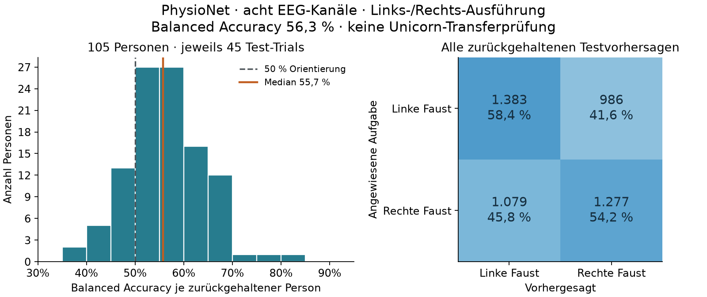

# PhysioNet: erste Baseline für linke/rechte Faustausführung

Stand: 29.10.2026. **Explorativer öffentlicher Offline-Benchmark:** Die vorhandene Achtkanal-Bandpower-Baseline erreicht bei vollständig zurückgehaltenen Personen **56,29 % Balanced Accuracy**. Das ist ein schwaches Ergebnis gegenüber dem 50-%-Orientierungswert des Zweiklassenkontrasts und kein Nachweis zuverlässiger Erkennung auf unserem Unicorn-Headset.

## Daten und festgelegte Pipeline

- PhysioNet EEG Motor Movement/Imagery, Version 1.0.0, tatsächliches linkes/rechtes Faustöffnen und -schließen aus Läufen 3/7/11. Herkunft, Lizenz, Download und Audit: [Datensatzanleitung](physionet-fist-data.md).
- **4.725 Aufgaben-Trials aus 105 Personen und 315 Aufnahmen:** 2.369 linke, 2.356 rechte Faust. Je Person drei Läufe mit insgesamt 45 Trials. Die bereits vor dem Training festgelegten Ausschlüsse bleiben unverändert: zwölf Aufnahmen aus `S088`, `S089`, `S092`, `S100`, insgesamt 202 Aufgaben. Keine weiteren Ausschlüsse nach Betrachtung der Modellleistung.
- Acht benannte Positionen in der Reihenfolge Fz, C3, Cz, C4, Pz, PO7, Oz, PO8; physische Volt aus MNE ausdrücklich in µV umgerechnet. Pro Trial 560 Quellsamples bei 160 Hz innerhalb der 0–3,5-s-Aufgabenhistorie; Offline-Resampling 25/16 auf 875 Samples bei 250 Hz. Keine zusätzlichen Originalsamples außerhalb dieser Historie, kein Rereferencing und keine Artefaktbereinigung.
- Dieselbe Merkmalsfunktion wie beim lokalen Bewegungsklassifikator: erstes Sample abziehen, kausaler Butterworth-Bandpass vierter Ordnung bei 7–35 Hz, 0,5 s Vorlauf verwerfen, logarithmische Welch-Bandpower in 8–13 und 13–30 Hz. Acht Kanäle ergeben 16 Merkmale; das Merkmalsfenster liegt bei 0,5–3,5 s nach Cue.
- `StandardScaler` und logistische Regression mit `C=1`, balancierten Klassengewichten, `max_iter=2000`, Seed 0. Kein Hyperparametervergleich, keine nachträgliche Modellauswahl und keine zusätzlichen Gewichte oder Pakete.
- Ausschließlich **zwei Klassen** (`me_hand_left`, `me_hand_right`). T0-Erholung, Fußaufgaben und Imagery werden nicht als Trainingsbeispiele übernommen. Keine Ruhe- oder Unknown-Klasse.

Der Codezustand des Laufs ist Commit `8f76606136a887ef02c07429b40ecb16c6ba74cd`. Das [kompakte JSON-Ergebnis](../analysis/results/physionet_fists_training_2026-10-29.json) enthält den vollständigen Verarbeitungsvertrag, Softwareversionen, Ausschlusszahlen und SHA-256-Prüfsummen von vorbereitetem Datensatz, Modell, vollständigem Bericht und gespeicherten Testvorhersagen.

## Auswertung und Ergebnis

**Leave-one-participant-out mit 105 Folds:** Je Fold sind alle drei Läufe und 45 Trials derselben Person gemeinsam Testdaten; die übrigen 4.680 Trials aus 104 Personen sind Training. Skalierung und Modell werden ausschließlich auf den Trainingspersonen gelernt. Jeder Trial erhält genau eine zurückgehaltene Vorhersage. Erst anschließend wird das exportierte Modell auf allen 4.725 Trials neu trainiert; dieses abschließende Modell erzeugt nicht die unten berichteten Testwerte.

| Metrik über alle zurückgehaltenen Testvorhersagen | Ergebnis |
|---|---:|
| Balanced Accuracy | **56,29 %** |
| Accuracy | 56,30 % |
| Macro-F1 | 0,5627 |
| Recall linke Faust | 58,38 % |
| Recall rechte Faust | 54,20 % |
| Trainingslauf einschließlich Datenprüfung und Export | **5,04 s gemessene Wandzeit** |

Die Laufzeit wurde mit `/usr/bin/time -p` auf diesem Mac gemessen: 4,40 s User- und 0,21 s Systemzeit. Sie umfasst das erneute Prüfen und Laden der vorbereiteten Daten, das Nachrechnen aller Merkmale, sämtliche Folds und den abschließenden Modell-/Berichtexport. Die vorherige Datensatzvorbereitung und die anschließende Ergebnisprüfung gehören nicht zu diesen fünf Sekunden. Keine GPU verwendet; keine allgemeine Laufzeitgarantie für andere Rechner.

Konfusionsmatrix; Zeilen sind angewiesene Aufgaben, Spalten Modellvorhersagen:

| Aufgabe \ Vorhersage | Linke Faust | Rechte Faust |
|---|---:|---:|
| Linke Faust | 1.383 | 986 |
| Rechte Faust | 1.079 | 1.277 |



## Streuung zwischen Personen

Die [Personentabelle](../analysis/results/physionet_fists_training_persons_2026-10-29.csv) enthält für alle 105 Personen Trialzahlen, Balanced Accuracy, Accuracy, Macro-F1 und Konfusionsmatrixeinträge. Personenkennungen sind öffentliche PhysioNet-Kennungen und bleiben von lokalen EVM-Teilnehmer-IDs getrennt.

| Personenbezogene Zusammenfassung | Ergebnis |
|---|---:|
| Ungewichteter Mittelwert der Balanced Accuracy | 56,33 % |
| Median | **55,73 %** |
| Standardabweichung | 8,04 Prozentpunkte |
| 25.–75. Perzentil | 50,79–61,76 % |
| Minimum–Maximum | **38,14–84,23 %** |
| Über / genau / unter 50 % | 83 / 2 / 20 Personen |
| Mindestens 70 % | 3 von 105 Personen |

Für die Streuung des ungewichteten Personenmittelwerts wurde zusätzlich ein **deskriptiver Personen-Bootstrap** berechnet: 10.000 Ziehungen von jeweils 105 bereits beobachteten Personenscores mit Zurücklegen, NumPy-Generator, Seed `20261029`. Die 2,5-/97,5-Perzentile liegen bei **54,79–57,90 %**. Dieser Bereich beschreibt die beobachtete Personenverteilung. Die Folds teilen Trainingspersonen; es ist deshalb kein formal unabhängiges Konfidenzintervall der vollständigen Lernprozedur und kein Signifikanztest gegen Zufall. Es wurde kein Permutationstest durchgeführt. Mit 45 Testtrials pro Person sind zudem die einzelnen Personenscores grob und unsicher.

## Durchgeführte Prüfungen und gespeicherte Dateien

Aus dem Repository-Stamm wurde tatsächlich ausgeführt:

```bash
/usr/bin/time -p ~/.venvs/eeg-ml/bin/python -m analysis.movement_classifier train-physionet \
  ~/.cache/eegvsmeg/physionet-eegmmidb-1.0.0/prepared-fists-250hz-v1 \
  --output-dir ~/.cache/eegvsmeg/physionet-eegmmidb-1.0.0/hand-side-model-v1

~/.venvs/eeg-ml/bin/python -m unittest \
  analysis.test_movement_classifier analysis.test_ml_pipeline analysis.test_reve_pipeline
```

**28 Regressionstests bestanden.** Zusätzlich wurden am echten Lauf geprüft:

- 4.725 eindeutige Trialkennungen, jeweils genau einmal getestet; 105 Personen, je 45 Testtrials und alle drei Läufe gemeinsam zurückgehalten.
- Gesamte und foldweise Metriken aus `predictions.csv` unabhängig nachgerechnet und mit `report.json` verglichen.
- Exportiertes Modell ohne Pickle neu geladen; gespeicherte Skalierungsparameter stimmen mit dem abschließenden Fit auf allen Eingabemerkmalen überein. Alle Modellwahrscheinlichkeiten sind endlich, haben Form 4.725 × 2 und summieren sich zeilenweise auf eins.
- Der Trainingsloader prüft die vorbereiteten Datei-Hashes und rechnet alle gespeicherten Merkmale aus den EEG-Historien nach. Keine Veränderung der Originalaufnahmen oder vorbereiteten Eingaben.

Software des Trainings: NumPy 2.5.4, SciPy 1.18.1, pandas 3.1.0, scikit-learn 1.9.1. Die Versionen der vorherigen EDF-Aufbereitung stehen im [Importsnapshot](../analysis/results/physionet_fists_import_2026-10-29.json).

Lokale vollständige Ausgaben liegen außerhalb des synchronisierten Repositorys:

```text
~/.cache/eegvsmeg/physionet-eegmmidb-1.0.0/hand-side-model-v1/
    movement-model.npz
    predictions.csv
    report.json
    report.md
```

Das Modell ist rund 45 KB groß; Parameter und vollständige Trialvorhersagen werden nicht eingecheckt. Bei Wiederholung einen **neuen** Ausgabeordner wählen. Der kleine JSON-Bericht und die Personentabelle im Repository sind abgeleitete Ergebnisberichte mit nachvollziehbarer Herkunft, keine EEG-Rohdaten.

## Einordnung und offene Arbeit

Die einfache Pipeline zeigt in diesem öffentlichen Datensatz eine begrenzte Links-/Rechts-Unterscheidung bei unbekannten Personen. Sie belegt weder eine robuste individuelle Erkennung noch reine neuronale Herkunft. Artefakte, visuelle Cues und tatsächliche Aufgabenbefolgung sind mit diesen technischen Prüfungen nicht ausgeschlossen. Unterschiede zwischen PhysioNet und Unicorn bei Gerät, Referenz, Kontakten und Cue-Ablauf bleiben bestehen.

Es fehlen ein unabhängiger abschließender Datensatz, lokale Transferprüfung und kontinuierliche Ruhe-/Störsituationen. Mit dieser Zweiklassen-Baseline werden keine kurzen Einzelgesten, keine Ruhe und keine Imagery erkannt. Der Modellvertrag bleibt auf öffentliche Daten begrenzt; lokale Auswertung beziehungsweise Gesten-Replay akzeptieren ihn nicht als bereits validierten Unicorn-Transfer. Ein sinnvoller späterer, separat dokumentierter Vergleich ist die im Protokoll vorgesehene CSP/FBCSP-Baseline; sie wurde in diesem Lauf nicht trainiert.
